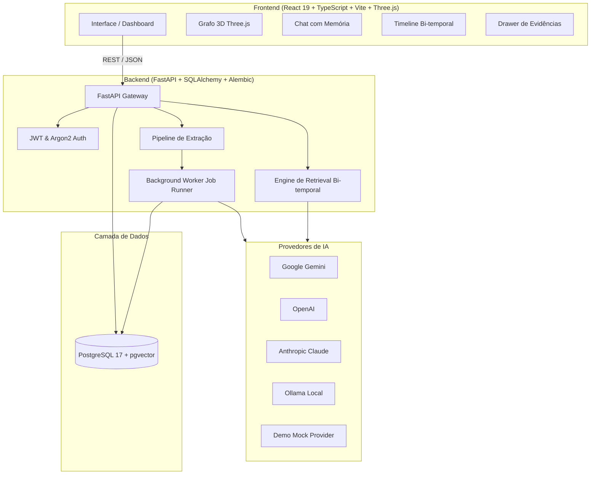

# 🧠 ECHO — Your Digital Twin & Bitemporal Memory Engine

<p align="center">
  
  
  
  
  
  
  
</p>

---

## 📌 Visão Geral (Overview)

**ECHO** é uma plataforma de **Gêmeo Digital (Digital Twin)** e **Memória Semântica Bi-temporal** projetada para construir um modelo cognitivo persistente, evolutivo e auditável do usuário ao longo do tempo.

Diferente de sistemas RAG convencionais baseados apenas em busca vetorial estática, o ECHO implementa um grafo de conhecimento temporal onde cada informação (*Claim*) possui linhagem completa de evidências (*Evidence*), histórico de versões (*Bitemporal Tracking*), detecção e resolução de conflitos, além de visualização espacial em 3D.

---

## ✨ Principais Funcionalidades

- **🗃️ Memória Bi-temporal & Linhagem de Evidências**:
  - Rastreamento duplo de tempo: *Valid Time* (quando o fato ocorreu) e *Transaction Time* (quando o sistema tomou conhecimento).
  - Classificação de claims: `explicit_statement`, `preference`, `goal`, `decision`, `inference` e `pattern`.
  - Estados auditáveis: `active`, `contested`, `retracted`.

- **🤖 Suporte Multi-Provedores de LLM & Embeddings**:
  - **Google Gemini** (Gemini 2.5 Flash + text-embedding-004)
  - **OpenAI** (GPT-4o-mini / GPT-4o + text-embedding-3-small)
  - **Anthropic Claude** (Claude 3.5 Sonnet)
  - **Ollama** (Modelos 100% locais: Llama 3.2, Nomic Embed Text)
  - **Modo Demo/Offline** (Mock determinístico para testes e desenvolvimento ágil)

- **🌌 Visualização Interativa em 3D (Three.js)**:
  - Grafo 3D renderizado em tempo real com física orbital, agrupamento por domínios (`Career`, `Learning`, `Projects`, `Other`) e conexões semânticas.

- **⏱️ Linha do Tempo & Trilha de Aprendizado**:
  - Visualização cronológica da evolução das memórias e metas.
  - Painel de progresso e trilha de desenvolvimento pessoal.

- **💬 Chat Contextual com Retrieval Avançado**:
  - Assistente que consulta dinamicamente a memória do usuário com citação explícita das fontes e evidências através de um *Evidence Drawer*.

- **⚙️ Pipeline Assíncrono com Background Workers**:
  - Processamento em segundo plano de episódios, extração estruturada de entidades e geração de vetores semânticos com `pgvector`.

---

## 🏗️ Arquitetura do Sistema



---

## 🚀 Como Executar o Projeto

### Pré-requisitos
- [Docker](https://www.docker.com/) e Docker Compose
- *Ou localmente:* [Python 3.12+](https://www.python.org/), [uv](https://docs.astral.sh/uv/) e [Node.js 20+](https://nodejs.org/)

---

### Opção 1: Via Docker Compose (Recomendado)

1. Clone o repositório:
```bash
git clone https://github.com/lucassantana2301-bot/ECHO.git
cd ECHO
```

2. Configure as variáveis de ambiente:
```bash
cp backend/.env.example backend/.env
```
*(Edite `backend/.env` para colocar suas chaves de API caso queira utilizar provedores em nuvem como Gemini, OpenAI ou Claude)*

3. Inicie todos os serviços:
```bash
docker compose up --build
```

- **Backend API**: `http://localhost:8000`
- **Swagger Docs**: `http://localhost:8000/docs`
- **Postgres + pgvector**: `localhost:5432`

---

### Opção 2: Execução Manual (Local)

#### 1. Backend (FastAPI + uv)

```bash
cd backend

# Instalar dependências usando uv
uv sync

# Configurar variáveis de ambiente
cp .env.example .env

# Executar migrações do banco
uv run alembic upgrade head

# Iniciar API
uv run uvicorn echo.api.main:app --host 0.0.0.0 --port 8000 --reload
```

Em outro terminal, execute o worker de background:
```bash
cd backend
uv run python -m echo.worker
```

#### 2. Frontend (React + Vite)

```bash
cd frontend

# Instalar dependências
npm install

# Iniciar servidor de desenvolvimento
npm run dev
```

Acesse a interface no navegador em: `http://localhost:5173`

---

## ⚙️ Configuração de Provedores de IA (`backend/.env`)

O backend suporta múltiplos provedores através da variável `ECHO_LLM_PROVIDER`:

```env
# Modo Offline/Demo (Padrão para desenvolvimento sem chaves):
ECHO_PROVIDER_MODE=demo

# Para usar Google Gemini:
ECHO_PROVIDER_MODE=live
ECHO_LLM_PROVIDER=gemini
ECHO_LLM_API_KEY=sua_chave_aqui
ECHO_LLM_MODEL=gemini-2.5-flash
ECHO_EMBED_PROVIDER=gemini
ECHO_EMBED_MODEL=text-embedding-004
ECHO_EMBED_DIM=768

# Para usar OpenAI:
ECHO_PROVIDER_MODE=live
ECHO_LLM_PROVIDER=openai
ECHO_LLM_API_KEY=sua_chave_aqui
ECHO_LLM_MODEL=gpt-4o-mini
ECHO_EMBED_PROVIDER=openai
ECHO_EMBED_MODEL=text-embedding-3-small
ECHO_EMBED_DIM=1536

# Para usar Ollama Local:
ECHO_PROVIDER_MODE=live
ECHO_LLM_PROVIDER=ollama
ECHO_LLM_BASE_URL=http://localhost:11434
ECHO_LLM_MODEL=llama3.2
ECHO_EMBED_PROVIDER=ollama
ECHO_EMBED_MODEL=nomic-embed-text
ECHO_EMBED_DIM=768
```

---

## 🧪 Testes Automatizados

Para rodar os testes do backend:

```bash
cd backend
uv run pytest
```

---

## 📁 Estrutura de Pastas

```
ECHO/
├── backend/
│   ├── alembic/                # Migrações de schema do banco
│   ├── src/echo/
│   │   ├── api/                # Endpoints FastAPI (auth, claims, episodes, retrieval)
│   │   ├── core/               # Configurações, segurança e hashing
│   │   ├── episodes/           # Ingestão e gerenciamento de episódios
│   │   ├── memory/             # Motor de memória, linhagem e claims
│   │   ├── pipeline/           # Pipelines de extração e consolidação
│   │   ├── providers/          # Adaptadores de LLM e Embeddings (Gemini, OpenAI, Claude, Ollama, Demo)
│   │   ├── retrieval/          # Motor de busca bi-temporal e semântica
│   │   ├── models.py           # Modelos ORM SQLAlchemy
│   │   ├── domain.py           # Enums e contratos de domínio
│   │   └── worker.py           # Execução de jobs em background
│   ├── tests/                  # Suíte de testes unitários e de integração
│   └── pyproject.toml
├── frontend/
│   ├── src/
│   │   ├── components/         # Componentes React (GraphView, ChatView, TimelineView, EvidenceDrawer)
│   │   ├── experience/         # Experiências visuais e shaders 3D
│   │   ├── services/           # Clientes HTTP e serviços de API
│   │   ├── App.tsx             # Aplicação principal e roteamento
│   │   └── index.css           # Design System e temas visuais
│   └── package.json
├── docker-compose.yml          # Orquestração do Postgres + API + Worker
└── README.md
```

---

## 📄 Licença

Este projeto é distribuído sob a licença MIT. Consulte o arquivo de licença para mais detalhes.
